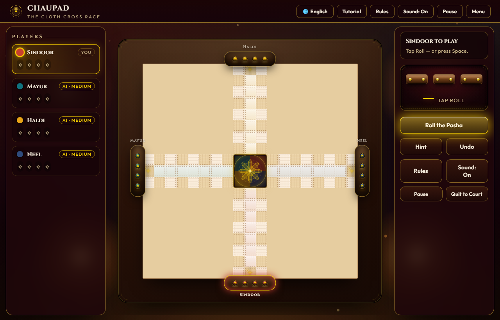
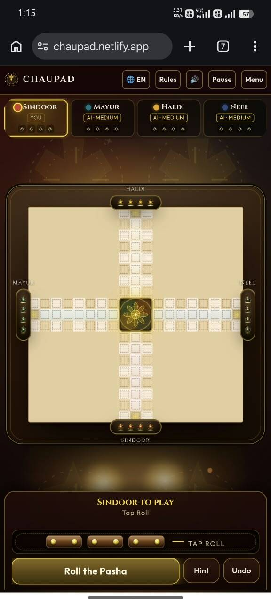
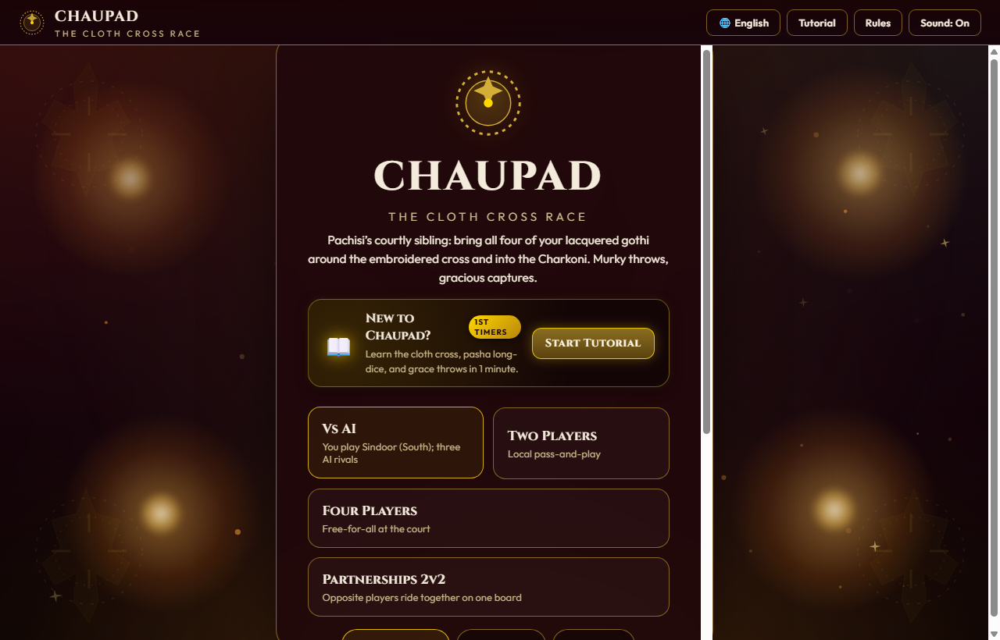
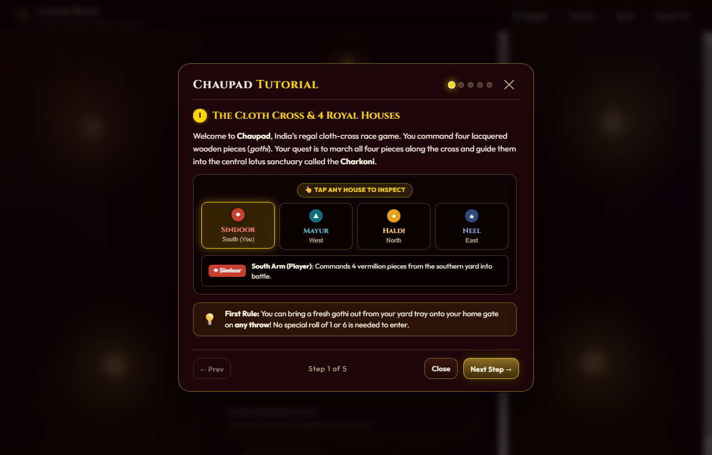
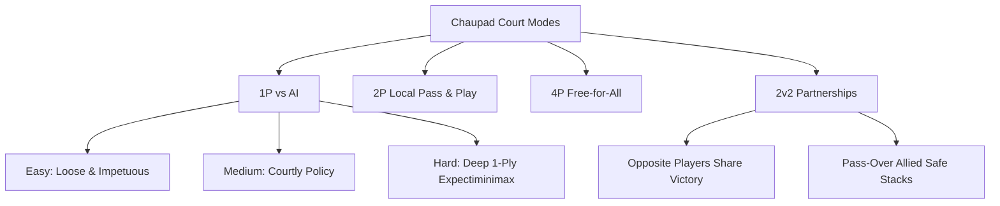

# Chaupad (चौपड़ / ଚୌପଡ଼) — The Cloth Cross Race

> **Pachisi’s Courtly Sibling • An Anthology of Native & Indigenous Sports of India (CUTM, 2025)**  
> *A playable heritage board-game prototype rendered in a Mughal–Rajput courtly zardozi aesthetic.*

[](#technical-architecture)
[](#rule-verification-suite)
[](#multilingual-support)
[](#mobile--phone-optimization)
[](#courtly-ambience--vfx)

---



---

## 📜 Table of Contents

1. [Overview & Cultural Heritage](#-overview--cultural-heritage)
2. [Embedded Gameplay & User Experience](#-embedded-gameplay--user-experience)
3. [The Court Menu & Configuration](#-the-court-menu--configuration)
4. [The Pasha Long-Dice & Throw Mechanics](#-the-pasha-long-dice--throw-mechanics)
5. [Board Architecture & Circuit Topology](#-board-architecture--circuit-topology)
6. [Interactive Tutorial & Illustrated Rules](#-interactive-tutorial--illustrated-rules)
7. [Core Rules & Winning Condition](#-core-rules--winning-condition)
8. [Game Modes & AI Calibre](#-game-modes--ai-calibre)
9. [Multilingual Support (EN / HI / OR)](#-multilingual-support-en--hi--or)
10. [Mobile & Phone Optimization](#-mobile--phone-optimization)
11. [Technical Architecture & Codebase](#-technical-architecture--codebase)
12. [Rule Verification Suite (Headless Tests)](#-rule-verification-suite-headless-tests)
13. [Running Locally](#-running-locally)
14. [Credits & References](#-credits--references)

---

## 🏛️ Overview & Cultural Heritage

**Chaupad** (*Chaupar*, *Chausar*) is one of India’s most revered antiquity race games, documented across classical epics, court chronicles, and royal miniatures of the Mughal and Rajput courts. While sharing a cruciform board structure with its sister game *Pachisi*, Chaupad distinguishes itself through its courtly dignity, use of three four-sided rectangular wooden stick-dice (**Pasha** / *Pasā*), and deep tactical interplay of safe castle sanctuaries, pawn squads, and grace-throw releases.

This digital edition honours the research and documentation of **Centurion University’s *Anthology of Native & Indigenous Sports of India* (CUTM, 2025)**. Built without third-party frameworks, it delivers a museum-grade experience featuring:

* **Mughal–Rajput Zardozi Aesthetics**: Rich crimson velvet, raw khadi silk cross-arms, and intricate metallic gold (*zari*) needlework.
* **Lacquered Gothi (Pawns)**: Handcrafted conical pawns in four royal house hues: **Sindoor** (Vermilion), **Mayur** (Peacock Teal), **Haldi** (Saffron Ochre), and **Neel** (Lapis Sapphire).
* **Flickering Diya Ambience**: Warm candlelight reflections, floating temple dust motes, and authentic tactile sound effects (hollow wooden dice tumble, lacquered pawn clacks, and victory sitar chords).

---

## 🎮 Embedded Gameplay & User Experience

Chaupad adapts fluidly across device form-factors with tailor-made layouts for both desktop widescreen displays and handheld mobile smartphones:

### Desktop & Mobile Interface Comparison

<p align="center">
  
  <br/>
  
</p>

### Interface Zones

| Region | Component | Description |
| :--- | :--- | :--- |
| **Top Bar** | Header & Global Controls | Displays royal crest, title, responsive language switcher (`🌐 EN` / `🌐 HI` / `🌐 OR`), Rules modal trigger, Sound ambience toggle, and Pause overlay. |
| **Player Ticker** | 4-Card HUD Scoreboard | Compact, overflow-proof player cards displaying player colour dot, house name, player tag (`YOU`, `AI • MEDIUM`, or `SEAT 1`), and four home gothi progress chips (`✦`). Glowing golden halo highlights active turn. |
| **The Cloth Board** | 19×19 Cruciform Grid | Embroidered cross featuring 72 loop perimeter cells, 8 safe starred Castles, 4 outer starting yard trays with brass markers, and the glowing central **Charkoni Lotus**. |
| **Turn Panel** | Live Status Box | Contextual banner showing active player and clean instructions without dangling punctuation (e.g., `"SINDOOR TO PLAY — Tap Roll"`). |
| **Pasha Dice Tray** | 3D Long-Dice Display | Three rectangular wooden long-dice rendered with ivory pip inlays that tumble and settle on interactive tap or roll action. |
| **Action Toolbar** | Primary & Auxiliary Controls | Prominent golden `Roll the Pasha` button, dynamic `Confirm Move` action, tactical `Hint` advisor, and immediate `Undo` step-back. |

---

## 🏛️ The Court Menu & Configuration

The initial court foyer allows players to select match formats, customize seats, calibrate AI rivals, and tune environmental ambience:



* **Mode Selection**: Quick toggle between *Vs AI*, *Two Players*, *Four Players*, and *Partnerships 2v2*.
* **Interactive Seats**: Tap individual court cushions to toggle human vs. AI control for each house.
* **AI Calibre Selection**: Easy (loose and impetuous), Medium (courtly policy), or Hard (expectiminimax lookahead).
* **Atmospheric Tuning**: Independent toggles for lamplit soundscapes and dust particle physics.

---

## 🎲 The Pasha Long-Dice & Throw Mechanics

Chaupad is played using **three four-sided rectangular long-dice** (*pasha*), traditionally carved from teakwood, ebony, bone, or brass.

### Pip Distribution & Roll Calculation
Each rectangular die possesses four elongated faces, numbered:
$$\text{Faces} = \{1, 2, 5, 6\}$$

When all three dice are cast, the sum of their faces determines the step count:
$$\text{Minimum Roll} = 1 + 1 + 1 = 3$$
$$\text{Maximum Roll} = 6 + 6 + 6 = 18$$

### Grace Throws (*Chau* / चौ)
* **The Chau (Grace Throw)**: A specific sacred throw combination (such as all three dice landing on matching grace faces or total roll exceeding normal boundaries) triggers **Chau!**.
* **Bonus Throw**: Rolling a Chau or capturing an opponent’s piece instantly rewards the player with an extra consecutive throw (up to a tournament maximum of 3 bonus throws per turn).
* **Releasing Pawns**: Gothi resting in the yard tray can enter their home gate onto the active circuit on any throw, marching outward into the arena.

---

## 🗺️ Board Architecture & Circuit Topology

The Chaupad board is a balanced cruciform cross containing four distinct arms meeting at a grand central sanctuary:

```
                         [ HALDI - North Yard ]
                                [Gate: 44]
                                 +---+---+---+
                                 | 43| 44| 45|
                                 +---+---+---+
                                 | 42| H1| 46|
                                 +---+---+---+
                                 | 41| H2| 47|
                                 +---+---+---+
                                 | 40| H3| 48|
                                 +---+---+---+
                                 | 39| H4| 49|
                                 +---+---+---+
                                 | 38| H5| 50|
                                 +---+---+---+
                                 | 37| H6| 51|
                                 +---+---+---+
                                 | 36| H7| 52|
 +---+---+---+---+---+---+---+---+---+---+---+---+---+---+---+---+---+---+
 | 63| 62| 61| 60| 59| 58| 57| 56|   CHARKONI   | 34| 33| 32| 31| 30| 29| 28| 27|
 +---+---+---+---+---+---+---+---+    LOTUS     +---+---+---+---+---+---+---+---+
 | 64| H1| H2| H3| H4| H5| H6| H7|   SANCTUARY  | H7| H6| H5| H4| H3| H2| H1| 26|  [NEEL Gate: 26]
 +---+---+---+---+---+---+---+---+               +---+---+---+---+---+---+---+---+  [East Yard]
 | 65| 66| 67| 68| 69| 70| 71| 0 |   (3x3 Grid) | 24| 23| 22| 21| 20| 19| 18| 17|
 +---+---+---+---+---+---+---+---+---+---+---+---+---+---+---+---+---+---+
[MAYUR Gate: 62]                 | 1 | H7| 15|
[West Yard]                      +---+---+---+
                                 | 2 | H6| 14|
                                 +---+---+---+
                                 | 3 | H5| 13|
                                 +---+---+---+
                                 | 4 | H4| 12|
                                 +---+---+---+
                                 | 5 | H3| 11|
                                 +---+---+---+
                                 | 6 | H2| 10|
                                 +---+---+---+
                                 | 7 | H1| 9 |
                                 +---+---+---+
                                 | 8 | S | 8 |
                                 +---+---+---+
                                [Gate: 8]
                        [ SINDOOR - South Yard ]
```

### Key Geographic Elements
1. **The Outer Loop (72 Cells)**: A continuous counter-clockwise race track traversing all four arms.
2. **The 8 Castles (Sanctuaries ⭐)**:
   * **4 Gate Castles**: Cell 8 (South), Cell 62 (West), Cell 44 (North), Cell 26 (East).
   * **4 Corner Castles**: Diagonal junctions between adjacent arms where pawns are safe from all capture.
3. **Private Home Columns (H1 to H7)**: The central lane of each arm accessible exclusively to that player’s returning pawns.
4. **The Charkoni Lotus**: The 3×3 golden hub where victorious gothi culminate their pilgrimage.

---

## 📖 Interactive Tutorial & Illustrated Rules

First-time players can launch an illustrated, 5-step interactive tutorial that explains the game step-by-step:



1. **The Cloth Cross & 4 Royal Houses**: Inspect houses (Sindoor, Mayur, Haldi, Neel) and pawn colors.
2. **Pasha Long-Dice & Throws**: Learn the $1, 2, 5, 6$ faces and grace combinations.
3. **Marching & Captures**: Test combat mechanics vs. safe Castle sanctuaries.
4. **Allied Squads & Stacking**: Learn how friendly pieces march together as reinforced columns.
5. **Descending into the Charkoni**: Exact gate count and triumphant arrival at the central Lotus.

---

## ⚔️ Core Rules & Winning Condition

### 1. The Counter-Clockwise Pilgrimage
Pawns enter at their respective home gate and traverse the perimeter of the cloth cross in a strict **counter-clockwise (वामावर्त)** path through all 4 quadrants (72 squares).

### 2. Capture Mechanics (⚔️)
* If a pawn lands on an enemy pawn situated on an ordinary (non-castle) square, the enemy piece is **captured**.
* The captured piece is sent back to its owner’s outer yard tray.
* The capturing player is immediately awarded a **bonus throw**.

### 3. Castle Sanctuary (🛡️)
* Castle squares (marked with gold eight-point stars) provide absolute sanctuary.
* No captures can occur on a Castle cell.
* Multiple pawns of the same house—or allied partners—can freely stack and form defensive squads.

### 4. Entering the Home Column & Charkoni Victory (🌸)
1. After completing the full 72-cell outer circuit, a gothi returns to its home gate.
2. An exact roll carries the piece **inward** down its private 7-cell home lane.
3. Any roll equal to or exceeding the remaining distance propels the gothi safely into the central **Lotus Charkoni**.
4. **Victory**: The first player (or partnership) to safely lead all **4 gothi** into the Charkoni wins the match and claims dominion over the court.

---

## 👑 Game Modes & AI Calibre

Chaupad supports four distinct court configurations:



* **1P vs Court AI**: Player commands Sindoor (South) against three automated rivals (Mayur, Haldi, Neel).
* **Two Players**: Local heads-up match between opposite houses (Sindoor vs Haldi).
* **Four Players**: Four human contenders sharing one device in a free-for-all race.
* **Partnerships 2v2**: Classical team format where South & North partner against East & West, capable of passing through allied pawns and sharing tournament victory.

### AI Engine Architecture
The AI engine implements a hybrid **heuristic policy + 1-ply expectiminimax evaluation**:
$$\text{Score}(M) = w_{\text{progress}} \cdot \Delta_{\text{dist}} + w_{\text{cap}} \cdot V_{\text{capture}} + w_{\text{home}} \cdot V_{\text{home}} - w_{\text{risk}} \cdot P_{\text{vulnerability}}$$
* **Easy**: Favours raw speed with loose defense.
* **Medium**: Balances capture opportunities with castle sanctuary protection.
* **Hard**: Deeply evaluates safety probabilities, bonus-turn chains, and squad preservation.

---

## 🌐 Multilingual Support (EN / HI / OR)

Chaupad is fully localized into three regional languages of India with native typographies:

| Feature / UI String | English (`en`) | हिन्दी (`hi`) | ଓଡ଼ିଆ (`or`) |
| :--- | :--- | :--- | :--- |
| **Title** | Chaupad — The Cloth Cross Race | चौपड़ — वस्त्र क्रॉस दौड़ | ଚୌପଡ଼ — ବସ୍ତ୍ର କ୍ରସ୍ ଦୌଡ଼ |
| **South House** | Sindoor | सिन्दूर | ସିନ୍ଦୂର |
| **West House** | Mayur | मयूर | ମୟୂର |
| **North House** | Haldi | हल्दी | ହଳଦୀ |
| **East House** | Neel | नील | ନୀଳ |
| **Pasha Action** | Roll the Pasha | पासा फेंकें | ପାଶା ଫିଙ୍ଗନ୍ତୁ |
| **Confirm Move** | Confirm Move | चाल की पुष्टि करें | ଚାଲ୍ ନିଶ୍ଚିତ କରନ୍ତୁ |
| **Grace Throw** | Chau · Bonus Throw! | चौ · अतिरिक्त फेंक! | ଚୌ · ବୋନସ ଫିଙ୍ଗା! |

* **Zero-Bilingual Leakage**: Pure single-language rendering across all screens (Menu, Topbar, Status HUD, Dice Tray, Scoreboard, Rules Modal, Pause Menu, and Tutorial).
* **One-Tap Language Switching**: Seamlessly toggle between languages from the top header or pause dialog without reloading or interrupting ongoing games.

---

## 📱 Mobile & Phone Optimization

The web app is optimized for mobile touchscreens:

* **Adaptive Scoreboard**: Responsive 3-tier vertical player cards (`.pcard`) with `overflow: hidden`, guaranteeing zero horizontal overflow across phone widths (320px–480px).
* **No Clipped Buttons**: Proportional flex layout ensures `Roll`, `Hint`, and `Undo` remain fully visible and comfortable to tap.
* **Clean Touch Status**: Dynamic regex cleans desktop keyboard shortcuts (`"or press Space"`) and trims trailing punctuation or dandas in English, Hindi, and Odia.
* **Wood Frame Breathing Room**: Auto-scaling `--cell` and `--pad` factors provide generous clearance for yard trays and labels (`HALDI`, `SINDOOR`, `MAYUR`, `NEEL`) without border clipping.
* **Compact Top Bar**: Responsive language badges (`🌐 EN` / `🌐 HI` / `🌐 OR`) preserve clean margins on narrow displays.

---

## 🛠️ Technical Architecture & Codebase

The application is structured as a zero-dependency, high-performance web bundle:

```
e:\Projects/
├── index.html                 # Complete monolithic game application (HTML5, CSS3, JS Engine)
├── test_rules.js              # Headless Monte Carlo & rule engine test suite (500 matches)
├── README.md                  # Project documentation & visual guide
├── 13_Chaupad.docx            # CUTM Indigenous Sports Research Reference
├── js/
│   └── engine/
│       └── BoardGraph.js      # Headless mathematical graph representation of the board
└── assets/
    └── images/
        ├── gameplay_desktop.png        # In-game desktop browser gameplay screenshot
        ├── gameplay_mobile.jpg         # Authentic in-game mobile phone screenshot
        ├── court_menu.png              # In-game court foyer & mode setup screenshot
        └── tutorial_modal.png          # In-game interactive illustrated tutorial screenshot
```

### Key Engineering Decisions
* **Zero Dependencies**: Pure HTML5 canvas, CSS Grid/Flexbox, and vanilla ES5/ES6 JavaScript. No bundlers or build steps required.
* **CSS Custom Properties**: Dynamic responsive scaling driven by `--cell` and `--pad` tokens calculated on every viewport resize.
* **Web Audio API**: Synthesized and sampled tactile acoustic feedback for wooden rolls, gothi placement, and fanfare chords.

---

## 🧪 Rule Verification Suite (Headless Tests)

The core game logic is independently verified via [`test_rules.js`](file:///e:/Projects/test_rules.js), a comprehensive headless test runner.

To execute the verification suite:
```bash
node test_rules.js
```

### Verification Output
```text
====================================================
  CHAUPAD (CHAUPAR) HEADLESS RULE VERIFICATION SUITE
====================================================

--- TEST 1: Pasha Dice Monte Carlo (100,000 Rolls) ---
Min roll: 3, Max roll: 18
Grace (चौ) Frequency: 6.26% (Theoretical: 6.25% or 4/64)
✔ PASHA DICE DISTRIBUTION VERIFIED.

--- TEST 2: Board Geometry & Safe Squares ---
Loop perimeter length: 72 cells (Expected: 72)
Gate indices: S=8, W=62, N=44, E=26
Safe Castle Tiles: 8 (4 gates + 4 corner junctions)
✔ BOARD TOPOLOGY VERIFIED.

--- TEST 3: 500-Match Headless Self-Play Simulation ---
  Completed 100/500 matches...
  Completed 200/500 matches...
  Completed 300/500 matches...
  Completed 400/500 matches...
  Completed 500/500 matches...

✔ 500/500 MATCHES COMPLETED IN 0.25s (100% SUCCESS)
  Average Turns Per Match: 180.9
  Average Captures Per Match: 9.4
  Victory Distribution: S=137, W=134, N=129, E=100
  Deadlocks / Soft-locks: 0
  Illegal Moves: 0

====================================================
  ALL VERIFICATION CRITERIA PASSED GREEN (500/500)
====================================================
```

---

## 🚀 Running Locally

Because Chaupad has no build dependencies, it can be launched instantly in any browser:

### Option 1: Direct File
Simply open `index.html` directly in Google Chrome, Mozilla Firefox, Safari, or Microsoft Edge.

### Option 2: Local HTTP Server
```bash
# Using Node.js
npx serve .

# Using Python 3
python -m http.server 8080

# Using PHP
php -S localhost:8080
```
Then navigate to `http://localhost:8080` in your browser.

---

## 🏅 Credits & References

* **Institutional Heritage**: Developed in alignment with *An Anthology of Native & Indigenous Sports of India* (Centurion University of Technology and Management, CUTM, 2025).
* **Research Material**: Documentation compiled in `13_Chaupad.docx` on traditional cross-and-circle race games.
* **Art & Design**: Inspired by authentic Mughal-era courtly khadi cross-cloths, Rajput miniature paintings, and antique wooden pasha dice artifacts from regional Indian heritage collections.

---

<p align="center">
  <b>Chaupad (चौपड़ / ଚୌପଡ଼)</b> • Preserving and Celebrating Indian Native Board Game Heritage
</p>
